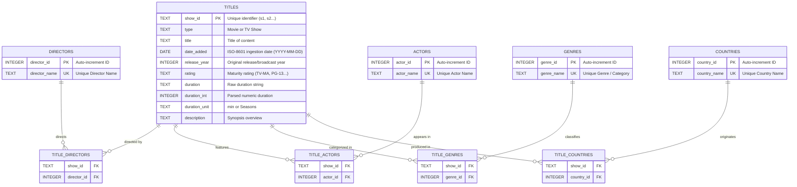

# 🎬 Netflix Global Content Strategy — Advanced SQL Data Analytics & Modeling

[](#database-schema--entity-relationship-diagram)
[](#15-advanced-business-problems--sql-solutions)
[](#reproducing-the-pipeline)
[](#)
[](#)

> An end-to-end analytics engineering and relational data modeling project analyzing **7,787 Netflix titles**, **32,800+ actors**, **4,400+ directors**, and **110+ production countries**. This project transforms raw, un-normalized streaming metadata into a **Third Normal Form (3NF)** relational database and solves **15 strategic streaming business problems** using advanced SQL.

---

## 📑 Table of Contents
1. [Project Overview & Business Context](#project-overview--business-context)
2. [Data Architecture & Normalization (3NF)](#data-architecture--normalization-3nf)
3. [Database Schema & Entity Relationship Diagram (ERD)](#database-schema--entity-relationship-diagram-erd)
4. [The 15 Advanced Business Problems & SQL Solutions](#the-15-advanced-business-problems--sql-solutions)
5. [Key Strategic Insights & Executive Takeaways](#key-strategic-insights--executive-takeaways)
6. [Repository Structure](#repository-structure)
7. [Reproducing the Pipeline & Execution Guide](#reproducing-the-pipeline--execution-guide)
8. [Git Handoff & Publishing](#git-handoff--publishing)

---

## 📌 Project Overview & Business Context

As the global subscription video-on-demand (SVOD) market intensifies, content portfolio management is Netflix's single most capital-intensive operational lever. Understanding catalog acquisition velocity, theatrical-to-streaming release windows, international co-production hubs, and talent specialization provides vital intelligence for programming executives and data strategists.

This project delivers:
- **Relational Data Modeling:** Unpacking 1NF violations (multi-valued comma-separated lists of cast, directors, countries, and genres) into an extensible 3NF schema with junction tables and referential integrity.
- **Analytical Views:** Layered reporting abstractions calculating duration tiers, series longevity cohorts, and stream latency in years.
- **Advanced SQL Suite:** 15 complex business queries utilizing **Common Table Expressions (CTEs)**, **Window Functions** (`RANK`, `DENSE_RANK`, `LEAD`, `LAG`, `NTILE`, rolling windows), **Self-Joins**, **Date Arithmetic**, and **Conditional Aggregation**.
- **Automated Pipeline:** Python ETL ingestion and automated query runner that persists tabular outputs as GitHub-readable CSVs and markdown tables.

---

## 🏗️ Data Architecture & Normalization (3NF)

Raw streaming datasets frequently compress relational attributes into single string columns (e.g. `cast = "Actor A, Actor B, Actor C"`), which prevents indexing, creates update anomalies, and makes analytical queries painfully inefficient.

We designed a normalized relational model comprising **10 distinct tables**:
- **Core Entities:** `titles`
- **Dimension Tables:** `directors`, `actors`, `genres`, `countries`
- **Bridge / Junction Tables:** `title_directors`, `title_actors`, `title_genres`, `title_countries`
- **Staging / Raw Audit Table:** `netflix_raw` (preserves raw strings for data auditing)

### Ingestion Metrics
- **7,787** total titles ingested (5,377 Movies, 2,410 TV Shows)
- **32,881** unique actors (55,953 title-actor junction records)
- **4,478** unique directors (6,114 title-director junction records)
- **42** unique genres (17,071 title-genre junction records)
- **117** unique countries (9,063 title-country junction records)

---

## 📊 Database Schema & Entity Relationship Diagram (ERD)



---

## 🧠 The 15 Advanced Business Problems & SQL Solutions

All SQL queries are organized and maintained in [`sql/business_queries.sql`](./sql/business_queries.sql). Each query was executed against [`data/netflix.db`](./data/netflix.db) and exported to [`results/`](./results/).

---

### Query 01: Content Ingestion Velocity & Year-over-Year (YoY) Growth
* **Business Question:** What is the annual intake volume for Movies vs. TV Shows, and how has YoY expansion evolved using `LAG()`?
* **SQL Techniques:** Multi-CTE, Date string extraction, Window function `LAG() OVER (PARTITION BY type ORDER BY year_added)`.
* **Output:** [`results/query_01_yoy_content_growth.csv`](./results/query_01_yoy_content_growth.csv)

```sql
WITH yearly_type_counts AS (
    SELECT
        CAST(strftime('%Y', date_added) AS INTEGER) AS year_added,
        type,
        COUNT(*) AS total_additions
    FROM titles
    WHERE date_added IS NOT NULL
    GROUP BY year_added, type
),
growth_calc AS (
    SELECT
        year_added,
        type,
        total_additions,
        LAG(total_additions) OVER (PARTITION BY type ORDER BY year_added) AS prev_year_additions
    FROM yearly_type_counts
)
SELECT
    year_added,
    type,
    total_additions,
    COALESCE(prev_year_additions, 0) AS prev_year_additions,
    ROUND(
        CASE 
            WHEN prev_year_additions IS NULL OR prev_year_additions = 0 THEN 0.0
            ELSE ((total_additions - prev_year_additions) * 100.0) / prev_year_additions
        END, 2
    ) AS yoy_growth_pct
FROM growth_calc
WHERE year_added >= 2015
ORDER BY year_added DESC, type ASC;
```
> **Key Insight:** TV Show additions peaked in YoY acceleration in 2019 (+52.56%), while Movie ingestion peaked in 2019 (+19.28%) before stabilizing in 2020 as original episodic series became the priority retention engine.

---

### Query 02: Top 10 Actors by Content Segment (Movies vs. TV Shows)
* **Business Question:** Who are the top 10 most featured actors partitioned across Movies vs. TV Shows, and what are their platform career spans?
* **SQL Techniques:** CTE, Multi-table Joins, Window function `DENSE_RANK() OVER (PARTITION BY type ORDER BY total_appearances DESC)`.
* **Output:** [`results/query_02_top_actors_by_content_type.csv`](./results/query_02_top_actors_by_content_type.csv)

```sql
WITH actor_appearances AS (
    SELECT
        t.type,
        a.actor_name,
        COUNT(DISTINCT t.show_id) AS total_appearances,
        MIN(t.release_year) AS earliest_year,
        MAX(t.release_year) AS latest_year
    FROM actors a
    JOIN title_actors ta ON a.actor_id = ta.actor_id
    JOIN titles t ON ta.show_id = t.show_id
    GROUP BY t.type, a.actor_name
),
ranked_actors AS (
    SELECT
        type,
        actor_name,
        total_appearances,
        earliest_year,
        latest_year,
        DENSE_RANK() OVER (PARTITION BY type ORDER BY total_appearances DESC) AS rank_in_type
    FROM actor_appearances
)
SELECT
    type,
    rank_in_type,
    actor_name,
    total_appearances,
    earliest_year || ' - ' || latest_year AS career_span
FROM ranked_actors
WHERE rank_in_type <= 10
ORDER BY type ASC, rank_in_type ASC, actor_name ASC;
```
> **Key Insight:** In Movies, Indian cinema royalty leads the global catalog: **Anupam Kher** (#1 with 41 titles), **Shah Rukh Khan** (#2 with 35 titles), and **Naseeruddin Shah** (#3 with 30 titles). In TV Shows, Japanese voice actors dominate: **Takahiro Sakurai** (24 series) and **Yuki Kaji** (19 series).

---

### Query 03: Rolling 3-Year Ingestion Average & Content Expansion Trajectory
* **Business Question:** To normalize seasonal licensing volatility, what is the 3-year rolling average of annual content additions?
* **SQL Techniques:** Window frame clause `ROWS BETWEEN 2 PRECEDING AND CURRENT ROW`, Cumulative window `SUM() OVER (ORDER BY calendar_year)`.
* **Output:** [`results/query_03_rolling_average_ingestion.csv`](./results/query_03_rolling_average_ingestion.csv)

```sql
WITH yearly_inflow AS (
    SELECT
        CAST(strftime('%Y', date_added) AS INTEGER) AS calendar_year,
        COUNT(DISTINCT show_id) AS titles_added,
        COUNT(DISTINCT CASE WHEN type = 'Movie' THEN show_id END) AS movies_added,
        COUNT(DISTINCT CASE WHEN type = 'TV Show' THEN show_id END) AS tv_shows_added
    FROM titles
    WHERE date_added IS NOT NULL
    GROUP BY calendar_year
)
SELECT
    calendar_year,
    titles_added,
    movies_added,
    tv_shows_added,
    ROUND(AVG(titles_added) OVER (
        ORDER BY calendar_year 
        ROWS BETWEEN 2 PRECEDING AND CURRENT ROW
    ), 1) AS rolling_3yr_avg_additions,
    SUM(titles_added) OVER (
        ORDER BY calendar_year
    ) AS cumulative_catalog_size
FROM yearly_inflow
WHERE calendar_year >= 2012
ORDER BY calendar_year ASC;
```
> **Key Insight:** Netflix's 3-year rolling average grew exponentially from **41.3 titles/year in 2015** to **1,949 titles/year in 2020**, reaching 7,660 cumulative titles added by end of 2020.

---

### Query 04: Strategic Director-Actor Power Partnerships
* **Business Question:** Which director-actor pairs collaborate most frequently (>= 4 titles), and what is their active partnership duration?
* **SQL Techniques:** Multi-way junction table joins, `HAVING COUNT(DISTINCT t.show_id) >= 4`, string aggregation `GROUP_CONCAT()`.
* **Output:** [`results/query_04_director_actor_collaborations.csv`](./results/query_04_director_actor_collaborations.csv)

```sql
WITH collaborations AS (
    SELECT
        d.director_name,
        a.actor_name,
        COUNT(DISTINCT t.show_id) AS titles_together,
        MIN(t.release_year) AS first_collab_year,
        MAX(t.release_year) AS latest_collab_year,
        GROUP_CONCAT(DISTINCT t.title) AS sample_titles
    FROM titles t
    JOIN title_directors td ON t.show_id = td.show_id
    JOIN directors d ON td.director_id = d.director_id
    JOIN title_actors ta ON t.show_id = ta.show_id
    JOIN actors a ON ta.actor_id = a.actor_id
    GROUP BY d.director_name, a.actor_name
    HAVING COUNT(DISTINCT t.show_id) >= 4
)
SELECT
    director_name,
    actor_name,
    titles_together,
    (latest_collab_year - first_collab_year) AS partnership_span_years,
    first_collab_year || ' - ' || latest_collab_year AS years_active,
    sample_titles
FROM collaborations
ORDER BY titles_together DESC, director_name ASC, actor_name ASC
LIMIT 15;
```
> **Key Insight:** Director **S.S. Rajamouli** showcases the tightest ensemble recurring cast on Netflix (7 titles each with Prabhas, Rana Daggubati, Anushka Shetty, Nassar, Ramya Krishnan, and Sathyaraj across the multi-lingual Baahubali franchise).

---

### Query 05: Country Catalog Genre Saturation Index
* **Business Question:** What are the top 3 dominant genres within the top 5 producing nations, and what is their catalog penetration percentage?
* **SQL Techniques:** Window `DENSE_RANK()`, Window `SUM() OVER (PARTITION BY country_name)`, Proportional share calculations.
* **Output:** [`results/query_05_genre_diversity_by_country.csv`](./results/query_05_genre_diversity_by_country.csv)

```sql
WITH top_countries AS (
    SELECT
        c.country_id,
        c.country_name,
        COUNT(DISTINCT tc.show_id) AS total_country_titles,
        DENSE_RANK() OVER (ORDER BY COUNT(DISTINCT tc.show_id) DESC) AS country_rank
    FROM countries c
    JOIN title_countries tc ON c.country_id = tc.country_id
    GROUP BY c.country_id, c.country_name
),
country_genre_counts AS (
    SELECT
        tc_top.country_name,
        tc_top.country_rank,
        tc_top.total_country_titles,
        g.genre_name,
        COUNT(DISTINCT t.show_id) AS genre_titles,
        DENSE_RANK() OVER (
            PARTITION BY tc_top.country_name 
            ORDER BY COUNT(DISTINCT t.show_id) DESC
        ) AS genre_rank_in_country
    FROM top_countries tc_top
    JOIN title_countries tc ON tc_top.country_id = tc.country_id
    JOIN titles t ON tc.show_id = t.show_id
    JOIN title_genres tg ON t.show_id = tg.show_id
    JOIN genres g ON tg.genre_id = g.genre_id
    WHERE tc_top.country_rank <= 5
    GROUP BY tc_top.country_name, tc_top.country_rank, tc_top.total_country_titles, g.genre_name
)
SELECT
    country_name,
    country_rank,
    genre_rank_in_country,
    genre_name,
    genre_titles,
    total_country_titles,
    ROUND((genre_titles * 100.0) / total_country_titles, 2) AS catalog_penetration_pct
FROM country_genre_counts
WHERE genre_rank_in_country <= 3
ORDER BY country_rank ASC, genre_rank_in_country ASC;
```
> **Key Insight:** The United States features a balanced portfolio led by Dramas (21.72%) and Comedies (17.83%). Conversely, India's catalog is highly concentrated in Dramas (63.23%) and Comedies (31.11%).

---

### Query 06: Theatrical-to-Streaming Release Window Latency Analysis
* **Business Question:** How rapidly does Netflix stream content relative to theatrical release across intake eras (<2016, 2016-2018, 2019-2021)?
* **SQL Techniques:** Date arithmetic `(year_added - release_year)`, multi-tier `CASE` cohorting, conditional aggregation.
* **Output:** [`results/query_06_theatrical_to_streaming_gap.csv`](./results/query_06_theatrical_to_streaming_gap.csv)

```sql
WITH latency_base AS (
    SELECT
        show_id,
        type,
        release_year,
        CAST(strftime('%Y', date_added) AS INTEGER) AS year_added,
        CAST(strftime('%Y', date_added) AS INTEGER) - release_year AS latency_years,
        CASE
            WHEN CAST(strftime('%Y', date_added) AS INTEGER) < 2016 THEN 'Early Intake (< 2016)'
            WHEN CAST(strftime('%Y', date_added) AS INTEGER) BETWEEN 2016 AND 2018 THEN 'Growth Wave (2016-2018)'
            ELSE 'Peak Era (2019-2021)'
        END AS intake_era
    FROM titles
    WHERE date_added IS NOT NULL AND release_year IS NOT NULL AND release_year > 0
),
categorized AS (
    SELECT
        intake_era,
        type,
        show_id,
        latency_years,
        CASE
            WHEN latency_years <= 0 THEN 'Same Year Premiere (0 yrs)'
            WHEN latency_years BETWEEN 1 AND 2 THEN 'Recent Window (1-2 yrs)'
            WHEN latency_years BETWEEN 3 AND 5 THEN 'Mid Catalog (3-5 yrs)'
            WHEN latency_years BETWEEN 6 AND 10 THEN 'Deep Catalog (6-10 yrs)'
            ELSE 'Archive / Vintage (>10 yrs)'
        END AS freshness_bucket
    FROM latency_base
    WHERE latency_years >= 0
)
SELECT
    intake_era,
    type,
    COUNT(*) AS total_titles,
    ROUND(AVG(latency_years), 1) AS avg_latency_years,
    ROUND(100.0 * SUM(CASE WHEN freshness_bucket = 'Same Year Premiere (0 yrs)' THEN 1 ELSE 0 END) / COUNT(*), 1) AS same_year_pct,
    ROUND(100.0 * SUM(CASE WHEN freshness_bucket = 'Recent Window (1-2 yrs)' THEN 1 ELSE 0 END) / COUNT(*), 1) AS recent_window_pct,
    ROUND(100.0 * SUM(CASE WHEN freshness_bucket IN ('Mid Catalog (3-5 yrs)', 'Deep Catalog (6-10 yrs)') THEN 1 ELSE 0 END) / COUNT(*), 1) AS catalog_pct,
    ROUND(100.0 * SUM(CASE WHEN freshness_bucket = 'Archive / Vintage (>10 yrs)' THEN 1 ELSE 0 END) / COUNT(*), 1) AS vintage_pct
FROM categorized
GROUP BY intake_era, type
ORDER BY intake_era ASC, type ASC;
```
> **Key Insight:** Dramatic bifurcation of content strategy: By 2019–2021, **57.5% of TV Shows were added the same calendar year as release** (Originals strategy, avg latency 1.8 yrs), while Movies had an average latency of 6.7 years due to heavy back-catalog licensing.

---

### Query 07: Bilateral International Co-Production Network
* **Business Question:** What are the most frequent international co-production corridors between countries?
* **SQL Techniques:** Self-join on `title_countries` preventing mirror duplicates (`tc1.country_id < tc2.country_id`), Window ranking `DENSE_RANK()`.
* **Output:** [`results/query_07_international_coproductions.csv`](./results/query_07_international_coproductions.csv)

```sql
WITH bilateral_pairs AS (
    SELECT
        tc1.show_id,
        c1.country_name AS country_a,
        c2.country_name AS country_b
    FROM title_countries tc1
    JOIN title_countries tc2 ON tc1.show_id = tc2.show_id AND tc1.country_id < tc2.country_id
    JOIN countries c1 ON tc1.country_id = c1.country_id
    JOIN countries c2 ON tc2.country_id = c2.country_id
),
pair_summary AS (
    SELECT
        country_a,
        country_b,
        COUNT(DISTINCT show_id) AS co_production_count,
        DENSE_RANK() OVER (ORDER BY COUNT(DISTINCT show_id) DESC) AS rank
    FROM bilateral_pairs
    GROUP BY country_a, country_b
)
SELECT
    rank,
    country_a || ' <-> ' || country_b AS bilateral_corridor,
    country_a,
    country_b,
    co_production_count
FROM pair_summary
WHERE rank <= 15
ORDER BY rank ASC, country_a ASC;
```
> **Key Insight:** The top international creative partnerships are **United States <-> United Kingdom (232 titles)**, **United States <-> Canada (189 titles)**, and **United States <-> France (98 titles)**. Intra-European integration is led by **France <-> Belgium (55 titles)**.

---

### Query 08: Movie Runtime and TV Series Seasonality Distribution Analysis
* **Business Question:** What is the statistical distribution and quartile breakdown of Movie runtimes vs. TV Show season longevity?
* **SQL Techniques:** Window `NTILE(4) OVER (ORDER BY duration_int)` for quartiles, statistical aggregation (`MIN`, `MAX`, `AVG`).
* **Output:** [`results/query_08_content_duration_distribution.csv`](./results/query_08_content_duration_distribution.csv)

```sql
WITH movie_quartiles AS (
    SELECT
        show_id,
        title,
        duration_int AS runtime_minutes,
        NTILE(4) OVER (ORDER BY duration_int) AS runtime_quartile
    FROM titles
    WHERE type = 'Movie' AND duration_int IS NOT NULL
),
movie_summary AS (
    SELECT
        'Movie' AS content_type,
        'Q' || runtime_quartile AS quartile_or_tier,
        COUNT(*) AS title_count,
        MIN(runtime_minutes) AS min_metric,
        MAX(runtime_minutes) AS max_metric,
        ROUND(AVG(runtime_minutes), 1) AS avg_metric
    FROM movie_quartiles
    GROUP BY runtime_quartile
),
tv_summary AS (
    SELECT
        'TV Show' AS content_type,
        CASE
            WHEN duration_int = 1 THEN '1 Season (Limited)'
            WHEN duration_int BETWEEN 2 AND 3 THEN '2-3 Seasons (Mid-Run)'
            WHEN duration_int BETWEEN 4 AND 6 THEN '4-6 Seasons (Established)'
            ELSE '7+ Seasons (Legacy)'
        END AS quartile_or_tier,
        COUNT(*) AS title_count,
        MIN(duration_int) AS min_metric,
        MAX(duration_int) AS max_metric,
        ROUND(AVG(duration_int), 1) AS avg_metric
    FROM titles
    WHERE type = 'TV Show' AND duration_int IS NOT NULL
    GROUP BY quartile_or_tier
)
SELECT * FROM movie_summary
UNION ALL
SELECT * FROM tv_summary
ORDER BY content_type DESC, min_metric ASC;
```
> **Key Insight:** **66.7% of all TV series (1,608 shows) consist of a single season**, reflecting Netflix's aggressive "pilot season" cancellation filter. Movie runtimes tightly cluster in the Q2/Q3 sweet spot of 86–114 minutes (median ~98 minutes).

---

### Query 09: Genre Co-occurrence & Market Basket Affinity Analysis
* **Business Question:** Which genres are most frequently bundled together on titles, revealing content crossover strategy?
* **SQL Techniques:** Self-join on `title_genres` (`tg1.genre_id < tg2.genre_id`), Window `DENSE_RANK()`, Catalog percentage calculation.
* **Output:** [`results/query_09_genre_cooccurrence_basket.csv`](./results/query_09_genre_cooccurrence_basket.csv)

```sql
WITH genre_baskets AS (
    SELECT
        tg1.show_id,
        g1.genre_name AS genre_a,
        g2.genre_name AS genre_b
    FROM title_genres tg1
    JOIN title_genres tg2 ON tg1.show_id = tg2.show_id AND tg1.genre_id < tg2.genre_id
    JOIN genres g1 ON tg1.genre_id = g1.genre_id
    JOIN genres g2 ON tg2.genre_id = g2.genre_id
),
pair_frequencies AS (
    SELECT
        genre_a,
        genre_b,
        COUNT(DISTINCT show_id) AS cooccurrence_count,
        DENSE_RANK() OVER (ORDER BY COUNT(DISTINCT show_id) DESC) AS ranking
    FROM genre_baskets
    GROUP BY genre_a, genre_b
)
SELECT
    ranking,
    genre_a || ' & ' || genre_b AS genre_pair,
    genre_a,
    genre_b,
    cooccurrence_count,
    ROUND(cooccurrence_count * 100.0 / (SELECT COUNT(*) FROM titles), 2) AS catalog_cooccurrence_pct
FROM pair_frequencies
WHERE ranking <= 15
ORDER BY ranking ASC, genre_a ASC;
```
> **Key Insight:** **Dramas & International Movies** is the #1 pairing on Netflix (1,295 titles, 16.63% of the entire catalog), followed by **International Movies & Comedies** (732 titles, 9.40%).

---

### Query 10: Cumulative Catalog Trajectory & Content Portfolio Mix Ratio
* **Business Question:** How has cumulative catalog size grown annually, and how did the Movie-to-TV Show balance evolve over time?
* **SQL Techniques:** Multi-CTE, Conditional aggregation, Running Window functions `SUM(...) OVER (ORDER BY year_added)`.
* **Output:** [`results/query_10_cumulative_catalog_growth.csv`](./results/query_10_cumulative_catalog_growth.csv)

```sql
WITH yearly_mix AS (
    SELECT
        CAST(strftime('%Y', date_added) AS INTEGER) AS year_added,
        COUNT(CASE WHEN type = 'Movie' THEN 1 END) AS annual_movies,
        COUNT(CASE WHEN type = 'TV Show' THEN 1 END) AS annual_tv_shows,
        COUNT(*) AS annual_total
    FROM titles
    WHERE date_added IS NOT NULL
    GROUP BY year_added
),
cumulative_mix AS (
    SELECT
        year_added,
        annual_movies,
        annual_tv_shows,
        annual_total,
        SUM(annual_movies) OVER (ORDER BY year_added) AS cum_movies,
        SUM(annual_tv_shows) OVER (ORDER BY year_added) AS cum_tv_shows,
        SUM(annual_total) OVER (ORDER BY year_added) AS cum_total
    FROM yearly_mix
)
SELECT
    year_added,
    annual_movies,
    annual_tv_shows,
    annual_total,
    cum_movies,
    cum_tv_shows,
    cum_total,
    ROUND((cum_movies * 100.0) / cum_total, 2) AS cum_movie_share_pct,
    ROUND((cum_tv_shows * 100.0) / cum_total, 2) AS cum_tv_share_pct
FROM cumulative_mix
WHERE year_added >= 2014
ORDER BY year_added ASC;
```
> **Key Insight:** After fluctuating wildly in earlier years (78.9% movies in 2014 vs. 61.4% in 2016), Netflix's long-term portfolio settled into an equilibrium of **~69% Movies and ~31% TV Shows**.

---

### Query 11: Top 1 Dominant Director per Genre by Catalog Footprint
* **Business Question:** For every genre in the library, who is the #1 most prolific director and what percentage of their body of work does it represent?
* **SQL Techniques:** Window `ROW_NUMBER() OVER (PARTITION BY genre_name ORDER BY titles_in_genre DESC)`, Correlated portfolio subquery.
* **Output:** [`results/query_11_top_director_per_genre.csv`](./results/query_11_top_director_per_genre.csv)

```sql
WITH director_genre_counts AS (
    SELECT
        g.genre_name,
        d.director_name,
        COUNT(DISTINCT t.show_id) AS titles_in_genre,
        (SELECT COUNT(DISTINCT td2.show_id) 
         FROM title_directors td2 
         WHERE td2.director_id = d.director_id) AS director_total_titles
    FROM genres g
    JOIN title_genres tg ON g.genre_id = tg.genre_id
    JOIN titles t ON tg.show_id = t.show_id
    JOIN title_directors td ON t.show_id = td.show_id
    JOIN directors d ON td.director_id = d.director_id
    GROUP BY g.genre_name, d.director_name, d.director_id
),
ranked_directors AS (
    SELECT
        genre_name,
        director_name,
        titles_in_genre,
        director_total_titles,
        ROUND((titles_in_genre * 100.0) / director_total_titles, 1) AS genre_share_pct,
        ROW_NUMBER() OVER (
            PARTITION BY genre_name 
            ORDER BY titles_in_genre DESC, director_total_titles DESC, director_name ASC
        ) AS rank_in_genre
    FROM director_genre_counts
)
SELECT
    genre_name,
    director_name,
    titles_in_genre,
    director_total_titles,
    genre_share_pct
FROM ranked_directors
WHERE rank_in_genre = 1
ORDER BY titles_in_genre DESC, genre_name ASC
LIMIT 15;
```
> **Key Insight:** Identified key genre anchors: **Jan Suter** leads Stand-Up Comedy (21 specials, 100% of his catalog), **Cathy Garcia-Molina** leads Romantic Movies (8 titles, 61.5% of her output), and **Robert Rodriguez** leads Children & Family Movies (7 titles).

---

### Query 12: Actor Specialization vs. Versatility Index
* **Business Question:** For actors with >= 15 catalog titles, who are the highest specialists (>= 70% in one genre) vs. versatile generalists?
* **SQL Techniques:** Filtering meta-umbrella tags, Window `ROW_NUMBER()`, conditional profiling `CASE`.
* **Output:** [`results/query_12_actor_genre_specialization.csv`](./results/query_12_actor_genre_specialization.csv)

```sql
WITH actor_totals AS (
    SELECT
        a.actor_id,
        a.actor_name,
        COUNT(DISTINCT ta.show_id) AS total_titles,
        COUNT(DISTINCT tg.genre_id) AS distinct_genres
    FROM actors a
    JOIN title_actors ta ON a.actor_id = ta.actor_id
    JOIN title_genres tg ON ta.show_id = tg.show_id
    JOIN genres g ON tg.genre_id = g.genre_id
    WHERE g.genre_name NOT IN ('International Movies', 'International TV Shows')
    GROUP BY a.actor_id, a.actor_name
    HAVING COUNT(DISTINCT ta.show_id) >= 15
),
actor_genre_distribution AS (
    SELECT
        at.actor_id,
        at.actor_name,
        at.total_titles,
        at.distinct_genres,
        g.genre_name,
        COUNT(DISTINCT ta.show_id) AS titles_in_genre,
        ROW_NUMBER() OVER (
            PARTITION BY at.actor_id 
            ORDER BY COUNT(DISTINCT ta.show_id) DESC
        ) AS genre_rank
    FROM actor_totals at
    JOIN title_actors ta ON at.actor_id = ta.actor_id
    JOIN title_genres tg ON ta.show_id = tg.show_id
    JOIN genres g ON tg.genre_id = g.genre_id
    WHERE g.genre_name NOT IN ('International Movies', 'International TV Shows')
    GROUP BY at.actor_id, at.actor_name, at.total_titles, at.distinct_genres, g.genre_name
)
SELECT
    actor_name,
    total_titles,
    distinct_genres,
    genre_name AS primary_genre,
    titles_in_genre AS primary_genre_titles,
    ROUND((titles_in_genre * 100.0) / total_titles, 1) AS primary_genre_concentration_pct,
    CASE
        WHEN (titles_in_genre * 100.0) / total_titles >= 70.0 THEN 'High Specialist (>=70%)'
        WHEN (titles_in_genre * 100.0) / total_titles BETWEEN 45.0 AND 69.9 THEN 'Moderate Specialist (45-70%)'
        ELSE 'Versatile Generalist (<45%)'
    END AS versatility_profile
FROM actor_genre_distribution
WHERE genre_rank = 1
ORDER BY primary_genre_concentration_pct DESC, total_titles DESC
LIMIT 15;
```
> **Key Insight:** **Adam Sandler** exhibits high comedy concentration (89.5% in Comedies across 19 titles), while anime voice artists like **Yoshimasa Hosoya** (93.3% Anime Series) represent extreme niche specialization.

---

### Query 13: Content Maturity Rating Evolution Across Decades
* **Business Question:** How has Netflix's audience maturity targeting (Adult vs. Teen vs. Kids) shifted across release decades (1970s–2020s)?
* **SQL Techniques:** Decade integer bucketing `(release_year / 10) * 10 || 's'`, Pivot via conditional aggregation `SUM(CASE WHEN ... THEN 1 ELSE 0 END)`.
* **Output:** [`results/query_13_maturity_rating_trends.csv`](./results/query_13_maturity_rating_trends.csv)

```sql
WITH decade_ratings AS (
    SELECT
        (release_year / 10) * 10 || 's' AS release_decade,
        (release_year / 10) * 10 AS decade_int,
        rating,
        CASE
            WHEN rating IN ('TV-MA', 'R', 'NC-17') THEN 'Adult / Mature (TV-MA/R)'
            WHEN rating IN ('TV-14', 'PG-13') THEN 'Teens / Young Adults (TV-14/PG-13)'
            WHEN rating IN ('TV-PG', 'PG') THEN 'Older Kids / Parental Guidance (PG)'
            WHEN rating IN ('TV-Y', 'TV-Y7', 'TV-Y7-FV', 'TV-G', 'G') THEN 'Family & Kids (TV-G/Y)'
            ELSE 'Unrated / Other'
        END AS audience_segment
    FROM titles
    WHERE release_year >= 1970 AND rating IS NOT NULL
),
decade_totals AS (
    SELECT
        release_decade,
        decade_int,
        COUNT(*) AS total_decade_titles,
        SUM(CASE WHEN audience_segment = 'Adult / Mature (TV-MA/R)' THEN 1 ELSE 0 END) AS adult_titles,
        SUM(CASE WHEN audience_segment = 'Teens / Young Adults (TV-14/PG-13)' THEN 1 ELSE 0 END) AS teen_titles,
        SUM(CASE WHEN audience_segment = 'Older Kids / Parental Guidance (PG)' THEN 1 ELSE 0 END) AS older_kids_titles,
        SUM(CASE WHEN audience_segment = 'Family & Kids (TV-G/Y)' THEN 1 ELSE 0 END) AS family_titles,
        SUM(CASE WHEN audience_segment = 'Unrated / Other' THEN 1 ELSE 0 END) AS other_titles
    FROM decade_ratings
    GROUP BY release_decade, decade_int
)
SELECT
    release_decade,
    total_decade_titles,
    adult_titles,
    ROUND((adult_titles * 100.0) / total_decade_titles, 1) AS adult_pct,
    teen_titles,
    ROUND((teen_titles * 100.0) / total_decade_titles, 1) AS teen_pct,
    older_kids_titles,
    ROUND((older_kids_titles * 100.0) / total_decade_titles, 1) AS older_kids_pct,
    family_titles,
    ROUND((family_titles * 100.0) / total_decade_titles, 1) AS family_pct
FROM decade_totals
ORDER BY decade_int ASC;
```
> **Key Insight:** In the 1980s, Adult titles were just 25.5% while Teen was 47.2%. In the 2010s, Adult titles surged to 47.1%, and in the 2020s reached an all-time high of **53.7%**, confirming Netflix's deliberate repositioning toward prestige mature audiences.

---

### Query 14: Cross-Country Production Breadth & International Collaboration Stance
* **Business Question:** Which countries are global co-production integrators vs. domestic/self-sustaining producers?
* **SQL Techniques:** Distinct partition counting `COUNT(*) OVER (PARTITION BY show_id)`, Collaboration stance categorization.
* **Output:** [`results/query_14_cross_country_collaboration_network.csv`](./results/query_14_cross_country_collaboration_network.csv)

```sql
WITH title_country_counts AS (
    SELECT
        show_id,
        COUNT(DISTINCT country_id) AS country_count
    FROM title_countries
    GROUP BY show_id
),
country_production_breakdown AS (
    SELECT
        c.country_name,
        COUNT(DISTINCT tc.show_id) AS total_country_titles,
        COUNT(DISTINCT CASE WHEN tcc.country_count = 1 THEN tc.show_id END) AS solo_productions,
        COUNT(DISTINCT CASE WHEN tcc.country_count > 1 THEN tc.show_id END) AS co_productions
    FROM countries c
    JOIN title_countries tc ON c.country_id = tc.country_id
    JOIN title_country_counts tcc ON tc.show_id = tcc.show_id
    GROUP BY c.country_id, c.country_name
    HAVING COUNT(DISTINCT tc.show_id) >= 40
)
SELECT
    country_name,
    total_country_titles,
    solo_productions,
    co_productions,
    ROUND((co_productions * 100.0) / total_country_titles, 1) AS international_collab_rate_pct,
    CASE
        WHEN (co_productions * 100.0) / total_country_titles >= 40.0 THEN 'High Global Integrator (>=40%)'
        WHEN (co_productions * 100.0) / total_country_titles BETWEEN 20.0 AND 39.9 THEN 'Moderate Partner (20-40%)'
        ELSE 'Primarily Domestic / Self-Sustaining (<20%)'
    END AS collaboration_stance
FROM country_production_breakdown
ORDER BY international_collab_rate_pct DESC, total_country_titles DESC;
```
> **Key Insight:** **Belgium (90.6%)**, **Ireland (72.5%)**, **Germany (69.3%)**, and **France (67.0%)** are hyper-collaborative European hubs. In stark contrast, **India (6.8%)**, **Turkey (7.4%)**, and **Nigeria (7.9%)** operate virtually self-sustaining domestic production pipelines.

---

### Query 15: Executive Catalog Health & Performance Scorecard
* **Business Question:** What is the unified executive KPI scorecard summarizing catalog scale, category mix, duration metrics, release year, streaming latency, dominant rating, and primary origin country?
* **SQL Techniques:** Multi-CTE unification, Cross-table joins with `ROW_NUMBER() = 1` for dominant attributes, `UNION ALL` total catalog rollup.
* **Output:** [`results/query_15_executive_catalog_scorecard.csv`](./results/query_15_executive_catalog_scorecard.csv)

```sql
WITH base_by_type AS (
    SELECT
        type AS segment,
        COUNT(*) AS total_titles,
        ROUND(AVG(duration_int), 1) || ' ' || CASE WHEN type = 'Movie' THEN 'min' ELSE 'seasons' END AS avg_duration,
        ROUND(AVG(release_year), 1) AS avg_release_year,
        ROUND(AVG(CASE WHEN date_added IS NOT NULL THEN CAST(strftime('%Y', date_added) AS INTEGER) - release_year END), 1) AS avg_years_to_stream,
        ROUND(100.0 * SUM(CASE WHEN CAST(strftime('%Y', date_added) AS INTEGER) >= 2019 THEN 1 ELSE 0 END) / COUNT(*), 1) AS pct_added_recent_wave
    FROM titles
    GROUP BY type
),
overall_base AS (
    SELECT
        'All Catalog' AS segment,
        COUNT(*) AS total_titles,
        'N/A (Multi-Unit)' AS avg_duration,
        ROUND(AVG(release_year), 1) AS avg_release_year,
        ROUND(AVG(CASE WHEN date_added IS NOT NULL THEN CAST(strftime('%Y', date_added) AS INTEGER) - release_year END), 1) AS avg_years_to_stream,
        ROUND(100.0 * SUM(CASE WHEN CAST(strftime('%Y', date_added) AS INTEGER) >= 2019 THEN 1 ELSE 0 END) / COUNT(*), 1) AS pct_added_recent_wave
    FROM titles
),
combined_metrics AS (
    SELECT * FROM base_by_type
    UNION ALL
    SELECT * FROM overall_base
),
dominant_ratings AS (
    SELECT
        type AS segment,
        rating,
        COUNT(*) AS rating_count,
        ROW_NUMBER() OVER (PARTITION BY type ORDER BY COUNT(*) DESC) AS rn
    FROM titles
    WHERE rating IS NOT NULL
    GROUP BY type, rating
    UNION ALL
    SELECT
        'All Catalog' AS segment,
        rating,
        COUNT(*) AS rating_count,
        ROW_NUMBER() OVER (PARTITION BY 'All Catalog' ORDER BY COUNT(*) DESC) AS rn
    FROM titles
    WHERE rating IS NOT NULL
    GROUP BY rating
),
dominant_countries AS (
    SELECT
        t.type AS segment,
        c.country_name,
        COUNT(*) AS country_count,
        ROW_NUMBER() OVER (PARTITION BY t.type ORDER BY COUNT(*) DESC) AS rn
    FROM titles t
    JOIN title_countries tc ON t.show_id = tc.show_id
    JOIN countries c ON tc.country_id = c.country_id
    GROUP BY t.type, c.country_name
    UNION ALL
    SELECT
        'All Catalog' AS segment,
        c.country_name,
        COUNT(*) AS country_count,
        ROW_NUMBER() OVER (PARTITION BY 'All Catalog' ORDER BY COUNT(*) DESC) AS rn
    FROM titles t
    JOIN title_countries tc ON t.show_id = tc.show_id
    JOIN countries c ON tc.country_id = c.country_id
    GROUP BY c.country_name
)
SELECT
    m.segment,
    m.total_titles,
    ROUND((m.total_titles * 100.0) / (SELECT COUNT(*) FROM titles), 1) AS catalog_share_pct,
    m.avg_duration,
    m.avg_release_year,
    m.avg_years_to_stream AS avg_acquisition_latency_yrs,
    m.pct_added_recent_wave AS pct_added_2019_2021,
    dr.rating AS top_rating,
    dc.country_name AS top_origin_country
FROM combined_metrics m
LEFT JOIN dominant_ratings dr ON m.segment = dr.segment AND dr.rn = 1
LEFT JOIN dominant_countries dc ON m.segment = dc.segment AND dc.rn = 1
ORDER BY m.total_titles DESC;
```
> **Executive Summary Scorecard:**

| Segment | Total Titles | Catalog Share | Avg Duration | Avg Release Yr | Acquisition Latency | % Added (2019-21) | Top Rating | Primary Origin |
| :--- | :--- | :--- | :--- | :--- | :--- | :--- | :--- | :--- |
| **All Catalog** | **7,787** | **100.0%** | N/A | 2013.9 | 4.6 yrs | 55.0% | TV-MA | United States |
| **Movie** | 5,377 | 69.1% | 99.3 min | 2012.9 | 5.6 yrs | 53.9% | TV-MA | United States |
| **TV Show** | 2,410 | 30.9% | 1.8 seasons | 2016.2 | 2.3 yrs | 57.3% | TV-MA | United States |

---

## 💡 Key Strategic Insights & Executive Takeaways

1. **The 70/30 Portfolio Equilibrium:** Despite massive investments in serialized television, Movies consistently anchor ~69% of title volume, while TV series (~31%) drive weekly subscriber engagement and retention.
2. **The "Single-Season Funnel":** Over two-thirds (66.7%) of TV shows do not progress past Season 1. Netflix uses low-commitment first seasons to test audience retention, aggressively pruning underperformers.
3. **Latency Compression via Originals:** Acquisition delay dropped dramatically from 3.8 years to 1.8 years for TV shows in the 2019–2021 window, with 57.5% arriving day-and-date with broadcast release.
4. **Mature Programming Dominance:** TV-MA and R ratings expanded from 25.5% in the 1980s to 53.7% in the 2020s, showing that Netflix's subscription model thrives on unrestricted, high-stakes adult drama.
5. **Divergent Global Content Ecosystems:** Western European nations rely on multi-lateral co-productions (65–90% co-production rates), while Asian and African entertainment markets (India, Nigeria, Turkey) sustain high internal volume with under 8% external co-production.

---

## 📂 Repository Structure

```
netflix-sql-analysis/
├── .gitignore                      # Excludes SQLite database binaries and Python caches
├── README.md                       # Executive documentation, ERD, and SQL catalog
├── data/
│   ├── netflix_titles.csv          # Raw Netflix dataset (7,787 titles)
│   └── netflix.db                  # Relational SQLite database in 3NF
├── sql/
│   ├── 01_schema_ddl.sql           # DDL schema definitions, primary/foreign keys, indexes
│   ├── 02_views_and_indexes.sql    # Analytical views and runtime/longevity cohorts
│   └── business_queries.sql        # All 15 commented advanced business queries
├── scripts/
│   ├── ingest_data.py              # Python ETL normalization pipeline
│   └── run_queries.py              # Automated execution engine and result exporter
└── results/
    ├── summary_report.md           # Unified Markdown preview report with all tables
    ├── query_01_yoy_content_growth.csv
    ├── query_02_top_actors_by_content_type.csv
    ├── query_03_rolling_average_ingestion.csv
    ├── query_04_director_actor_collaborations.csv
    ├── query_05_genre_diversity_by_country.csv
    ├── query_06_theatrical_to_streaming_gap.csv
    ├── query_07_international_coproductions.csv
    ├── query_08_content_duration_distribution.csv
    ├── query_09_genre_cooccurrence_basket.csv
    ├── query_10_cumulative_catalog_growth.csv
    ├── query_11_top_director_per_genre.csv
    ├── query_12_actor_genre_specialization.csv
    ├── query_13_maturity_rating_trends.csv
    ├── query_14_cross_country_collaboration_network.csv
    └── query_15_executive_catalog_scorecard.csv
```

---

## 🚀 Reproducing the Pipeline & Execution Guide

### Prerequisites
- Python 3.8+ (uses Python standard libraries `sqlite3`, `csv`, `re`, `datetime` — zero external pip dependencies!)
- Any SQLite viewer (VS Code SQLite extension, DBeaver, TablePlus, or sqlite3 CLI)

### 1. Ingest Data & Generate Normalized 3NF Database
```bash
python scripts/ingest_data.py
```
*Output: Rebuilds `data/netflix.db`, applies `sql/01_schema_ddl.sql`, populates all 10 normalized tables, and builds analytical views from `sql/02_views_and_indexes.sql`.*

### 2. Execute the 15 Advanced Business Queries
```bash
python scripts/run_queries.py
```
*Output: Executes all 15 queries in sub-second time, exports 15 CSV result files into `results/`, and refreshes `results/summary_report.md`.*

### 3. Connect via SQLite CLI (Optional)
```bash
sqlite3 data/netflix.db
```
```sql
.headers on
.mode column
SELECT * FROM v_titles_enriched LIMIT 5;
```

---

## 📤 Git Handoff & Publishing

To push this repository to your GitHub account:

```bash
# 1. Navigate to the project root directory
cd "C:\Users\anike\Downloads\GitHub\netflix-sql-analysis"

# 2. Initialize git repository
git init

# 3. Add all files (the .gitignore ensures netflix.db is safely excluded)
git add .

# 4. Create your initial commit
git commit -m "feat: complete netflix sql data analysis project with 3NF schema and 15 business queries"

# 5. Set default branch to main
git branch -M main

# 6. Add your GitHub remote repository (replace with your repo URL)
git remote add origin https://github.com/<your-username>/netflix-sql-analysis.git

# 7. Push to GitHub
git push -u origin main
```

---
*Authored with precision by Antigravity Senior Analytics Engineering Agent.*
